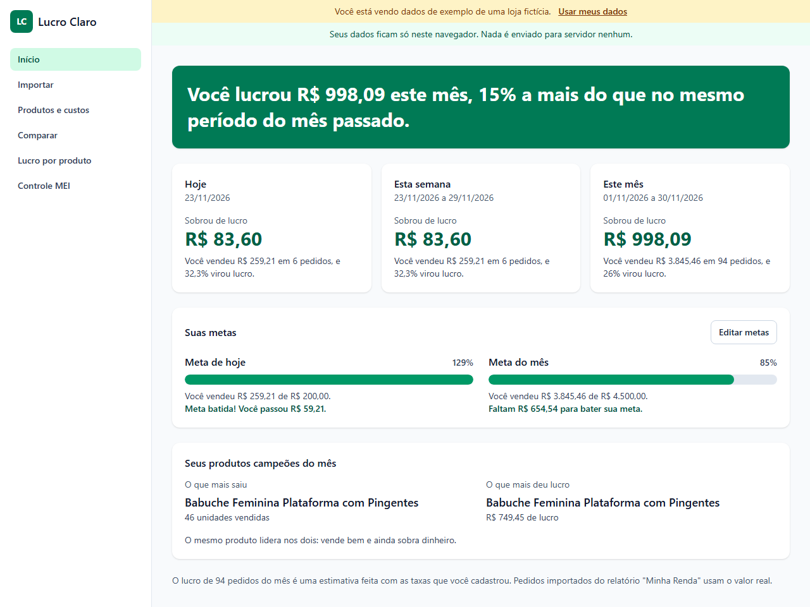
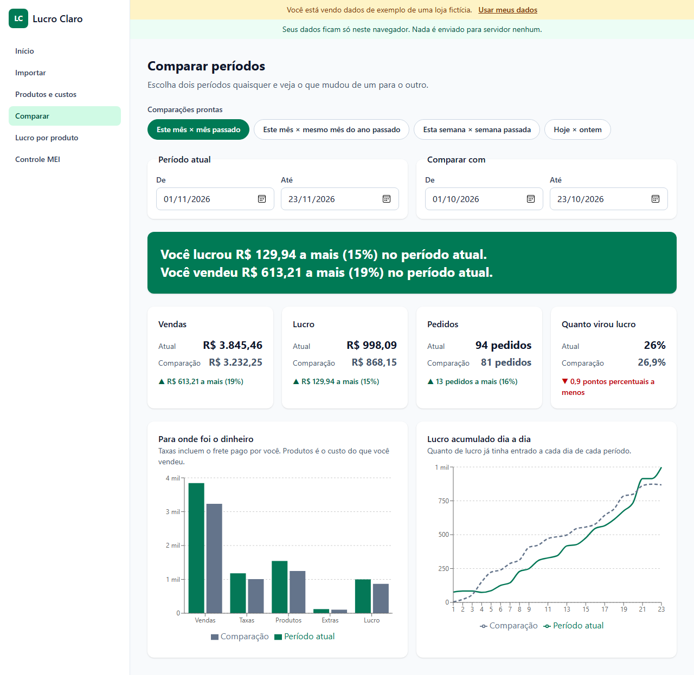
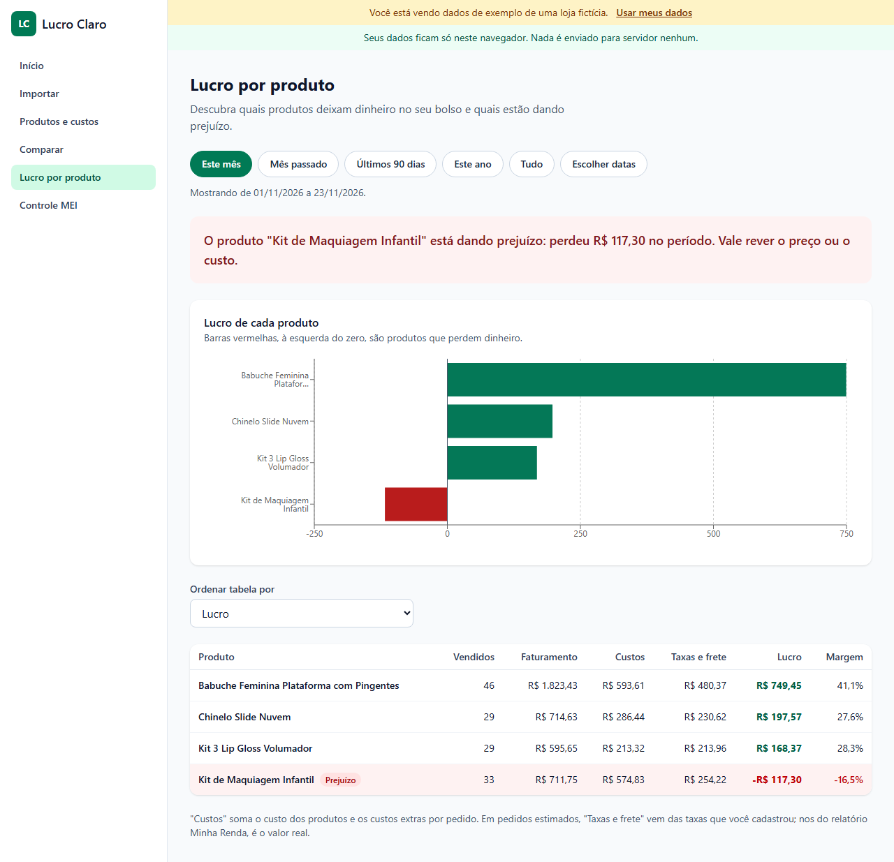

# Lucro Claro

Painel web que mostra o **lucro real** da loja de um MEI que vende em marketplaces, em linguagem simples e com gráficos, para quem não conhece termos como GMV ou ROAS.

**Demonstração:** abra o link do projeto na Vercel. Ele já abre com dados fictícios de uma loja (babuche, lip gloss, maquiagem infantil), então não precisa importar nada.



## O problema

A Central do Vendedor da Shopee mostra vendas, mas não responde perguntas simples do dia a dia:

- Quanto **sobrou de verdade** depois das taxas, do custo do produto, da sacola e da etiqueta?
- Qual produto está dando **prejuízo** sem eu perceber?
- Estou perto do **limite de faturamento do MEI**?
- Este mês foi melhor ou pior que o mês passado?

O projeto nasceu de uma necessidade real: sou vendedor MEI na Shopee e fazia essas contas na mão.

## A solução

O Lucro Claro lê os relatórios exportados da Central do Vendedor e transforma em respostas diretas, como *"Você lucrou R$ 998,09 este mês, 15% a mais do que no mesmo período do mês passado"* e *"Faltam R$ 654,54 para bater sua meta"*.

| Tela | O que responde |
| --- | --- |
| **Início** | Lucro de hoje, da semana e do mês, metas com barra de progresso e produtos campeões |
| **Importar** | Lê o relatório `.xlsx` ou `.csv`, reconhece as colunas e deixa corrigir o mapeamento |
| **Produtos e custos** | Custo de cada produto, custos extras por pedido e taxas da plataforma com data de vigência |
| **Comparar** | Dois períodos quaisquer lado a lado, em frases, cartões e gráficos |
| **Lucro por produto** | Tabela e gráfico com vendas, custos, lucro e margem, destacando o que dá prejuízo |
| **Controle MEI** | Faturamento do ano contra o limite, alerta a partir de 80%, projeção e lembrete do DAS |




## Privacidade em primeiro lugar

Não existe servidor. O arquivo é lido no navegador, e os dados ficam salvos só no computador de quem usa (IndexedDB). Nada é enviado pela internet. O importador lê apenas as colunas necessárias: nome, dados bancários e usuários dos compradores presentes no relatório nunca são lidos nem guardados, e há um teste automatizado que garante isso.

## Como o lucro é calculado

```
Lucro = faturamento
        − taxas da plataforma
        − custo dos produtos
        − custos extras por pedido (sacola, etiqueta, fita...)
        − frete pago pelo vendedor
```

Há dois modos, e a tela sempre diz qual está em uso:

- **Real:** quando o pedido vem do relatório "Minha Renda", o lucro parte do valor que realmente caiu na carteira, com comissão, taxas e frete já descontados.
- **Estimado:** quando não há o valor real, as taxas são calculadas com a comissão e a taxa fixa cadastradas. Cada cadastro vale a partir de uma data, para uma mudança de taxa não alterar o lucro de pedidos antigos.

## Tecnologias

- **React 19** e **TypeScript**, com **Vite**
- **Tailwind CSS 4** para o visual responsivo
- **React Router** para as telas
- **Recharts** para os gráficos
- **Dexie** (IndexedDB) para guardar os dados no navegador
- **SheetJS** para ler `.xlsx` e `.csv`
- **Vitest** para os testes, **oxlint** para o lint
- Deploy na **Vercel**

## Como rodar

Pré-requisito: Node.js 20 ou superior.

```bash
npm install
npm run dev
```

Outros comandos:

```bash
npm test
npm run build
npm run lint
```

## Decisões técnicas

**Dinheiro em centavos, sempre inteiro.** Em JavaScript, `0.1 + 0.2` dá `0.30000000000000004`. Com inteiros, somar milhares de pedidos nunca "perde" centavos. Só converto para reais na hora de mostrar. Os custos do pedido são repartidos entre os itens pelo método do maior resto, para a soma dos itens sempre bater com o total.

**Cálculos em funções puras e testadas.** Lucro, margem, metas, períodos, comparação, limite do MEI e as frases mostradas na tela ficam fora do React, em `src/services`. É onde um erro custa caro para o usuário, então são quase 200 testes cobrindo bordas como mês de 28 dias, dia 31 do DAS, base de comparação zero e meta batida com folga.

**Datas como texto `aaaa-mm-dd`.** Evita que um pedido de 31/10 vire 30/10 por causa de fuso horário. A comparação de períodos usa o mesmo trecho dos dois lados (dia 1 ao dia de hoje), para não comparar um mês incompleto com um mês inteiro.

**Camada de fonte de dados isolada.** As telas só conhecem a interface `OrdersDataSource`. A planilha e a demonstração são duas implementações dela, e a integração com a API da Shopee entra como uma terceira, sem reescrever telas nem cálculos.

**Demonstração em banco separado.** Os dados fictícios são gerados de forma determinística e ficam em um banco próprio, então nunca se misturam com os dados reais do usuário.

**Acessibilidade.** O significado nunca depende só da cor (setas e texto no "a mais" e "a menos", selo "Prejuízo"), as abas e os gráficos têm descrições para leitores de tela, e tudo funciona pelo teclado.

**SheetJS pelo endereço oficial.** A versão do npm está desatualizada e tem vulnerabilidades conhecidas, então a instalação usa o pacote do `cdn.sheetjs.com`.

## Estrutura

```
src/
├─ app/            rotas, layout e modo de dados (demonstração ou real)
├─ pages/          uma tela por arquivo
├─ components/     componentes de cada tela e componentes de interface
├─ hooks/          carregam dados e entregam prontos para as telas
├─ services/
│  ├─ calculations/  lucro, metas, períodos, comparação, ranking, MEI
│  ├─ import/        leitura da planilha e conversão em pedidos
│  └─ format/        moeda, datas, porcentagens e frases
├─ data-sources/   interface de origem dos pedidos (planilha, demonstração)
├─ db/             banco no navegador e repositórios
├─ demo/           gerador dos dados fictícios
└─ types/          tipos do domínio
```

## Limitações conhecidas

- O relatório "Minha Renda" **não informa a quantidade** vendida. O importador conta 1 unidade por produto e avisa na tela. O relatório de Pedidos resolve isso.
- Os limites e as regras do MEI mostrados no app são uma ajuda de acompanhamento e não substituem um contador. Confirme no Portal do Empreendedor.
- Os dados ficam em um único navegador: trocar de computador exige importar de novo.

## Próximos passos

- **Integração com a API oficial da Shopee (Open Platform)**, trocando a importação manual por sincronização automática, como uma nova fonte de dados.
- Leitura do relatório de **Pedidos**, para ter a quantidade exata e os pedidos ainda não liberados.
- Exportar e importar um backup dos dados.
- Remover produtos cadastrados e agrupar variações do mesmo produto.

## Autor

Matheus, estudante de Análise e Desenvolvimento de Sistemas e vendedor MEI.
